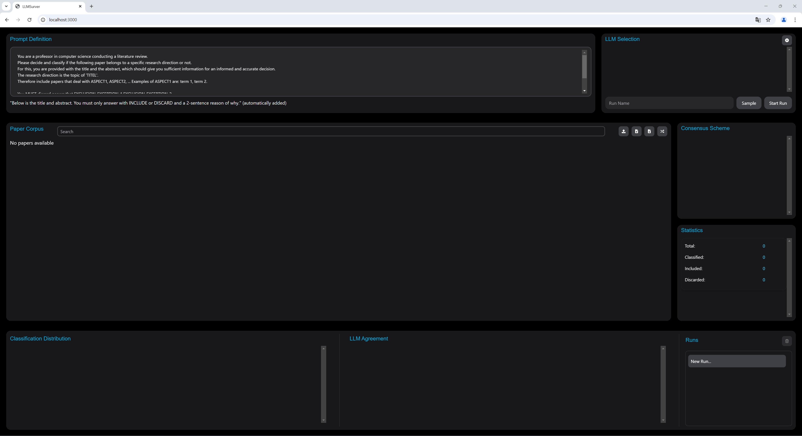
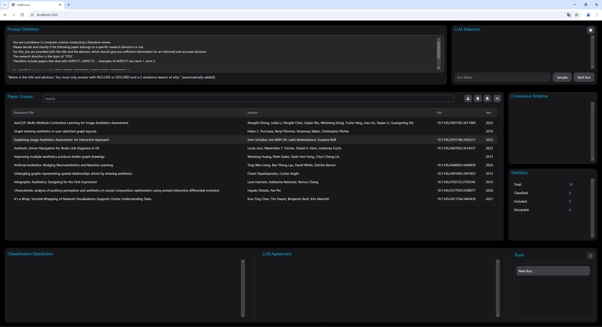
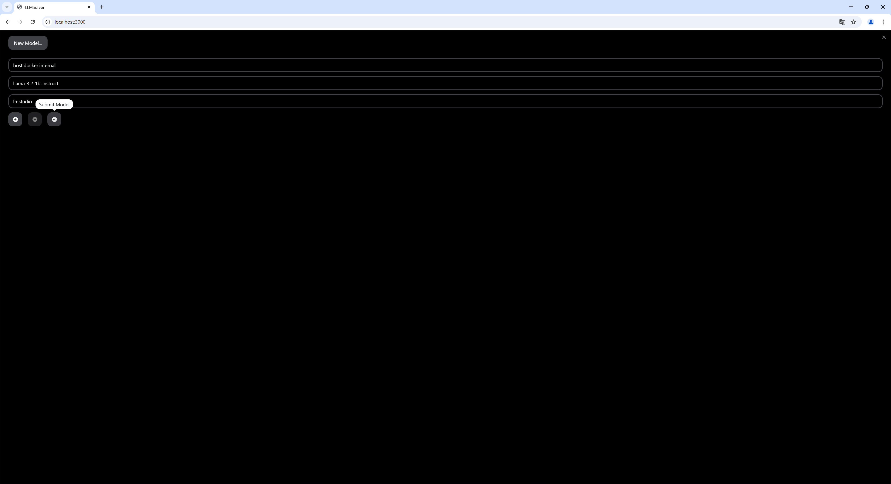
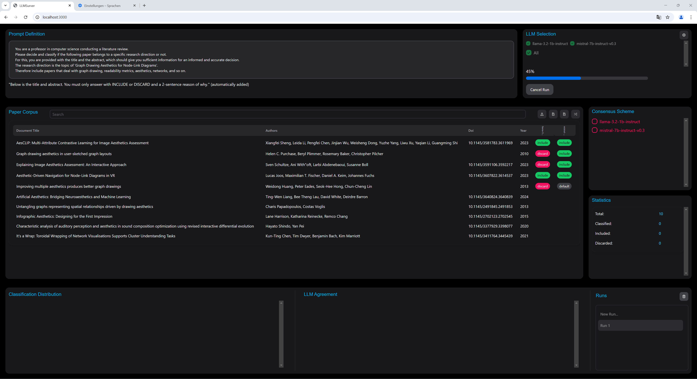
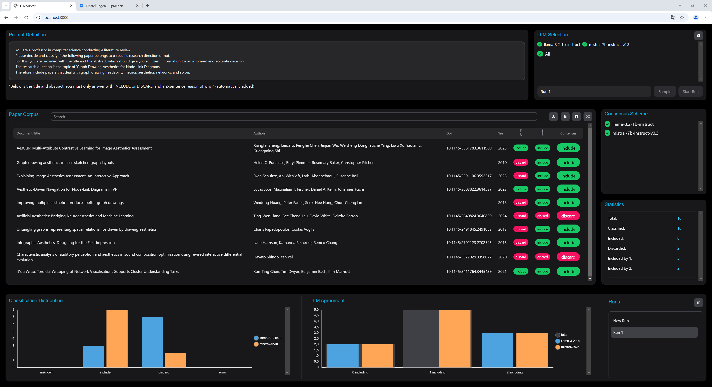

# Documentation

After opening the web app, the application is ready to be used:

### 1. Import paper corpus
First upload some papers; this can be done with a .bib file or by pasting a DOI or BibTeX using the first or second button above the table.

### 2. Add LLMs

Using the button in the top right of the page, you can add new LLMs or modify existing ones. A host, model name, key, and further parameters (e.g. temperature, etc.) can be set. If you run a local LLM on your machine, use `host.docker.internal` instead of `localhost` as a hostname.

### 3. Define and start the classification

After defining LLMs, a run name, a prompt, and selecting the models of interest, the run can be started. In parallel, every paper is passed to the corresponding LLMs with the defined prompt, the results are stored in the database, and visualized in real time in the frontend.

### 4. Interact with results

When the run is completed, the results can be viewed, statistics can be analyzed, and the concensus scheme can be adapted until a sufficient classification has been reached. Additionally, the prompt can be improved and a new run can be started.

