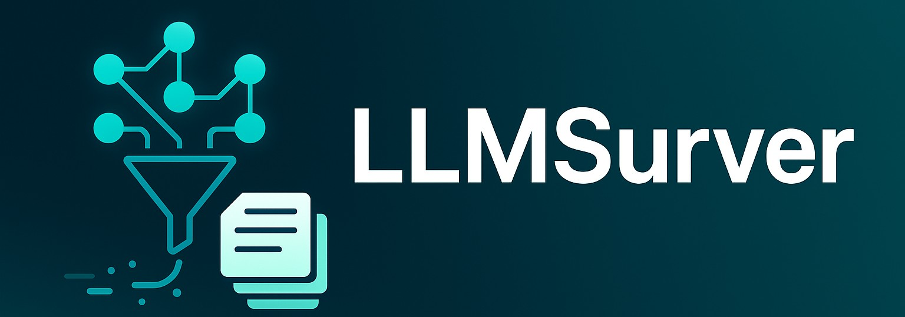
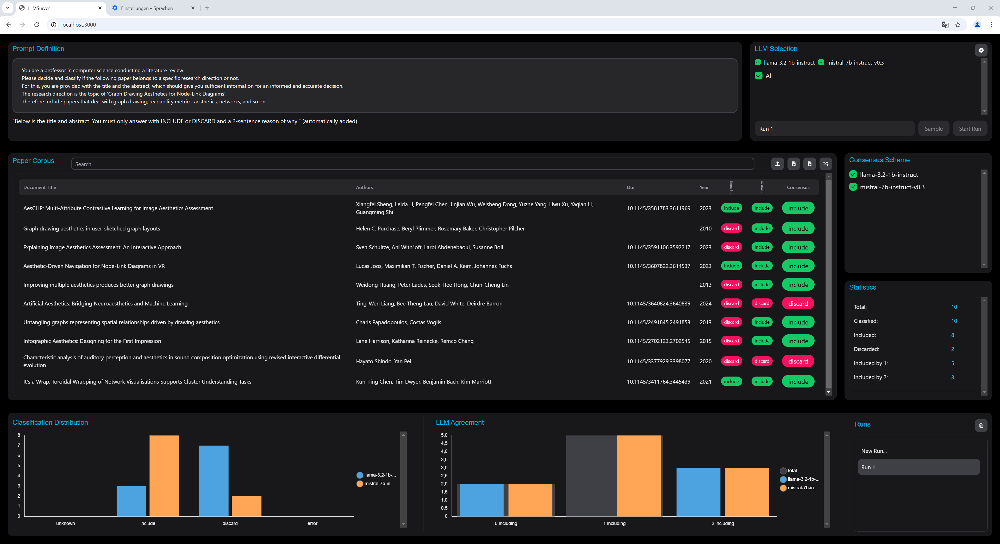

<p align="center">
  <a href="https://github.com/dbvis-ukon/LLMSurver"></a>
</p>

<p align="center">
    <em>LLMSurver - Automatic LLM-based literature review filtering inside your browser</em>
</p>

---

**LLMSurver** is an automatic structured literature review creation tool for filtering a paper corpus through a textual description using multiple LLMs for consensus voting, while running entirely in your browser.

The key features are:

* **Fast**: Reduces filtering time for academic corpora from weeks to minutes
* **Accurate**: A multi-LLM consensus scheme can achieve recall rates > 98.8%, often better than humans *
* **Interactive**: Interactively refine your research direction, using prompt refinement, resampling, and different LLM agents
* **Easy**: Try it out directly in your browser, no installation needed
* **Flexible**: Supports any OpenAI-compatible LLM endpoints, enabling you to use both commercial as well as locally-run LLMs
* **Privacy**: LLMsurver is entirely browser-based, the paper corpus is only provided to LLMs that you supply and control

<small>* estimation based on ablation studies in our research paper, see [below](#citing-this-work).</small>

## Try it out online

LLMSurver is available as a web app at [https://llmsurver.dbvis.de](https://llmsurver.dbvis.de).

Your data remains fully local and within your browser (except for the LLM calls that are directed to your supplied, personal LLM endpoints).
*Note*: You require OpenAI-compatible endpoint(s) (i.e. either a public endpoint with auth secret, e.g. `OpenAI`, `Gemini`, `Claude`, ... or a locally running LLM server like `Ollama`, `LMStudio`, ...).

## Citing this Work

This work is part of a research prototype for evaluating the potential of LLMs for literature filtering when generating systematic literature reviews and surveys published in the following **paper**.

To reference this repository and our work, please cite the original [publication](https://diglib.eg.org/handle/10.2312/eurova20251105):

```
Lucas Joos, Daniel A. Keim, and Maximilian T. Fischer. "Cutting Through the Clutter: The Potential of LLMs for Efficient Filtration in Systematic Literature Reviews" in EuroVis Workshop on Visual Analytics (EuroVA), 2025. doi: 10.2312/eurova.20251105.
```

##### BibTeX

```
@inproceedings{JoosKeimFischer.LLMLiteratureFiltration.2025,
  author = {Joos, Lucas and Keim, Daniel A. and Fischer, Maximilian T.},
  booktitle = {EuroVis Workshop on Visual Analytics (EuroVA)},
  doi = {10.2312/eurova.20251105},
  title = {Cutting Through the Clutter: The Potential of LLMs for Efficient Filtration in Systematic Literature Reviews},
  url = {https://diglib.eg.org/handle/10.2312/eurova20251105},
  year = 2025
}
```

## Research Prototype and Code



This repository contains the source code for LLMSurver. It is structured as follows:

* `frontend/`
  This folder contains the React frontend.

Please note, this is not a commercial product and the code quality for this proof-of-concept work is not production ready.

##### Architecture

The application consists of a single Docker container with the frontend based on React that contains all graphical content and GUI elements and the control and API logic. The data is stored inside your browser in an IndexedDB.

##### Development

To start the application for development, a system with Docker installed and an internet connection is required.
With the following command, the system can be started:

```Bash
docker-compose up
```

The system will be available under `http://127.0.0.1:3000` after compilation.


## Documentation

**Documentation**: A tutorial and overview is available under [DOCUMENTATION.md](/DOCUMENTATION.md).

## Authors

* Lucas Joos, DBVIS Research Lab, University of Konstanz, Germany
* Daniel A. Keim, DBVIS Research Lab, University of Konstanz, Germany
* Maximilian T. Fischer, DBVIS Research Lab, University of Konstanz, Germany

## License

This project is licensed under the terms of the MIT license.